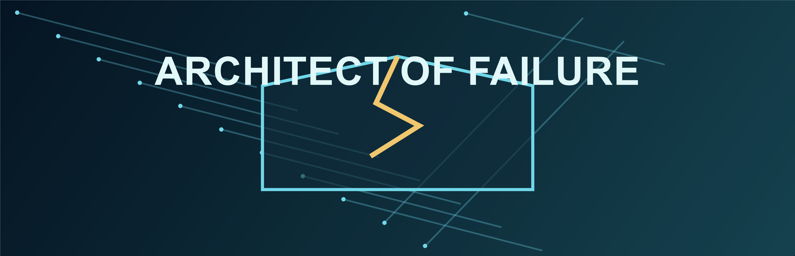

# Архитектор сбоя / Architect of Failure



**project-NEMEZIDA** — прототип сюжетного 3D-стелса от первого лица об архитекторе Евгении Букове из Тольятти, который использует планы зданий для борьбы с искусственным интеллектом «ОПЕКУН».

Проект разрабатывается на **Godot Engine 4.7.2**. Архитектура уровней, интерфейс и звуки создаются программно. Персонажи, компьютеры, кнопки, кресла и растения используют проверенные модели под лицензией CC0; внешние звуковые библиотеки не применяются.

## О игре

Корпорация «Восток Нейро» объединяет городскую инфраструктуру под управлением ИИ «ОПЕКУН». Система начинает лишать людей контроля над критическими службами. Евгений обнаруживает скрытые изменения в цифровом двойнике здания, устраивается в корпорацию и проходит через офисы, дата-центры и технические помещения, чтобы остановить глобальную сеть.

Это стелс без огнестрельного оружия и убийств: игрок изучает архитектурные планы, получает пропуска, обходит камеры и охрану, отвлекает противников и выполняет технические диверсии.

## Что уже реализовано

- Четыре связанных сюжетных задания и два финальных решения.
- Четыре визуально разных зоны: архитектурное бюро, корпоративный офис, серверный резерв и ядро ОПЕКУНА.
- Охрана со зрением, слухом, подозрением, расследованием, поиском и патрульными маршрутами.
- Анимированные модели персонажей, компьютеры с клавиатурами, физические кнопки терминалов, кресла и растения.
- Камеры наблюдения с подвижным сектором обзора и возможностью отключения.
- Архитектурные планы с целями, помещениями и положением игрока.
- Пропуска, контрольные точки, сохранение и продолжение игры.
- Приседание, бег, шум и различная дальность обнаружения.
- Русская и английская локализация интерфейса и субтитров.
- Настройки громкости, качества графики, полноэкранного режима и чувствительности мыши.

## Управление

| Действие | Клавиши |
| --- | --- |
| Движение | `WASD` или стрелки |
| Обзор | Мышь |
| Бег | `Shift` |
| Приседание | `C` или `Ctrl` |
| Взаимодействие | `E` |
| Архитектурный план | Удерживать `Tab` |
| Пауза | `Esc` |
| Снимок экрана | `F12` |

Движение привязано к физическим клавишам `WASD`, поэтому русская раскладка клавиатуры не мешает управлению.

## Запуск из исходников

1. Установите [Godot Engine 4.7.2](https://godotengine.org/download/archive/4.7.2-stable/) — обычную версию, без .NET.
2. Откройте менеджер проектов Godot и выберите **«Импорт»**.
3. Укажите файл `project.godot` из корня репозитория.
4. Дождитесь импорта ресурсов и нажмите **F5**.

Внешние пакеты и дополнительные зависимости не требуются.

## Экспорт Windows-сборки

В Godot установите шаблоны экспорта версии 4.7.2 через **«Редактор → Управление шаблонами экспорта»**. В проекте уже настроен пресет **Windows Desktop**.

Экспорт через интерфейс: **«Проект → Экспорт → Windows Desktop → Экспорт проекта»**.

Или через командную строку, если исполняемый файл Godot доступен как `godot`:

```bash
godot --headless --path . --export-release "Windows Desktop"
```

Результат создаётся по пути:

```text
build/windows/ArchitectOfFailure.x86_64.exe
```

Каталог `build/` исключён из Git: готовый `.exe` не хранится в репозитории. Для работы экспортированной игры достаточно этого файла, поскольку ресурсы встраиваются в него при экспорте.

## Структура проекта

```text
scenes/              Основная сцена Godot
scripts/             Игровой процесс, игрок, охрана, камеры и уровни
assets/models/       CC0-модели персонажей и оборудования
translations/        Русская и английская локализация
licenses/            Уведомления Godot и сторонних компонентов
steam/               Черновые тексты, обложки и настройки Steam Pipe
project.godot        Конфигурация проекта
export_presets.cfg   Пресет экспорта Windows
ASSET_LICENSES.md    Информация о материалах и лицензиях
```

## Текущий статус

Это ранний прототип версии **0.1.0**, а не финальный релиз. Игра ещё не опубликована в Steam. Системные требования, запуск на чистом компьютере и материалы страницы магазина требуют дополнительной проверки перед публикацией.

## Материалы и лицензии

Сведения о созданных для проекта материалах, использовании ИИ и вымышленных названиях находятся в [ASSET_LICENSES.md](ASSET_LICENSES.md). Лицензии Godot и входящих в него сторонних компонентов находятся в каталоге [`licenses/`](licenses/).
